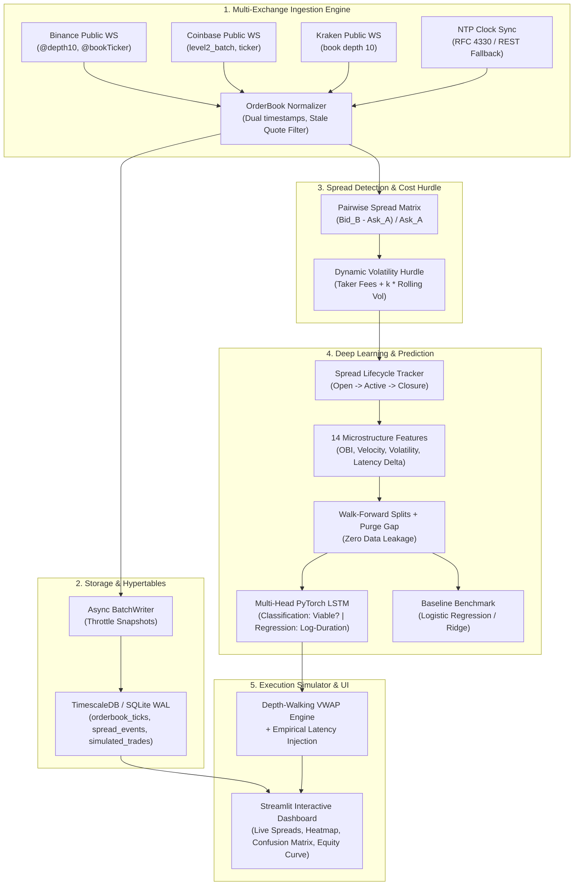

# ArbSense: AI-Powered Cross-Exchange Arbitrage Intelligence Engine

[](https://www.python.org/downloads/)
[](https://opensource.org/licenses/MIT)
[](https://pytorch.org/)
[](https://www.timescale.com/)

**Department of Computer Science & Engineering | M V S R Engineering College**  
*Team Members: Akshara (2451-23-733-050), Keerthana (2451-23-733-056), Kusmitha (2451-23-733-060)*  
*Project Guide: P. Subhashini*

---

## 1. Executive Summary

Traditional cryptocurrency arbitrage bots rely on simplistic fixed-spread thresholds, generating high rates of false-positive trade signals because they ignore the temporal persistence of price gaps and realistic market microstructure frictions (exchange fee schedules, order-book depth slippage, and network latency).

**ArbSense** resolves this limitation by introducing an **AI prediction layer**:
1. **Live Ingestion Layer:** Concurrently streams Level 2 order book depth from **Binance**, **Coinbase**, and **Kraken** via asynchronous public WebSockets without authentication or private API keys.
2. **Detection Layer:** Calculates pairwise cross-exchange directional spreads, filters stale quotes, aligns timestamps via sub-millisecond NTP sync, and enforces dynamic volatility-adjusted cost hurdles.
3. **AI Prediction Core:** A multi-head **PyTorch LSTM** forecasts spread time-to-closure ($\ln(\text{duration})$ regression) and opportunity viability ($F_1 > 75\%$ classification), validated via walk-forward chronological splits with purge gaps against scikit-learn baselines.
4. **Execution Simulator:** Validates opportunities using depth-walking VWAP across real order-book levels and empirical latency injection under a pre-funded balance assumption.
5. **Analytics Dashboard:** A multi-tab interactive **Streamlit** dashboard visualizing live spreads, depth imbalances, model diagnostic curves, and cumulative net P&L equity curves.

---

## 2. System Architecture



---

## 3. Mathematical Foundations

### 3.1 Directional Cross-Exchange Spread
For any directed exchange route $A \to B$ (Buy on Venue $A$, Sell on Venue $B$):
$$\text{GrossSpread}_{A \to B} = \frac{\text{Bid}_B - \text{Ask}_A}{\text{Ask}_A} \times 10,000 \quad (\text{bps})$$

### 3.2 Dynamic Cost Hurdle Model
An opportunity is flagged as candidate when $\text{GrossSpread} \ge \text{GrossThreshold}$, and evaluated for net viability against:
$$\text{Hurdle}_{A \to B} = \text{Fee}_A^{\text{taker}} + \text{Fee}_B^{\text{taker}} + k \cdot \sigma_{\text{rolling}}$$
where $\sigma_{\text{rolling}}$ is the rolling sample standard deviation of relative price returns over the preceding $N$ ticks, and $k$ is a configurable volatility multiplier.

### 3.3 Microstructure Signals (Order Book Imbalance)
Order Book Imbalance (OBI) across the top $k$ levels captures buying vs selling pressure:
$$\text{OBI}_k = \frac{\sum_{i=1}^k V_{\text{bid}, i} - \sum_{i=1}^k V_{\text{ask}, i}}{\sum_{i=1}^k V_{\text{bid}, i} + \sum_{i=1}^k V_{\text{ask}, i}} \in [-1.0, 1.0]$$

### 3.4 Depth-Walking Realized VWAP
Rather than assuming infinite liquidity at top-of-book, the simulator walks down order book depth for trade size $Q$:
$$\text{VWAP}_{\text{buy}} = \frac{\sum_{i} P_{\text{ask}, i} \cdot q_i}{Q}, \quad \text{VWAP}_{\text{sell}} = \frac{\sum_{j} P_{\text{bid}, j} \cdot q_j}{Q}$$
Slippage is naturally embedded in realized VWAP without double-counting.

### 3.5 Ground-Truth Labeling & Multi-Task Loss
- **Duration:** $\tau = t_{\text{close}} - t_{\text{open}}$, with target $y_{\text{reg}} = \ln(1 + \tau)$.
- **Viability:** Binary target $y_{\text{cls}} = 1$ if $\tau \ge \tau_{\text{execution}}$ and $\text{PeakSpread} \ge \text{Hurdle}$, else $0$.
- **Multi-Task Objective:**
  $$\mathcal{L} = \mathcal{L}_{\text{WeightedBCE}}(\hat{y}_{\text{cls}}, y_{\text{cls}}) + 0.5 \cdot \mathcal{L}_{\text{SmoothL1}}(\hat{y}_{\text{reg}}, y_{\text{reg}})$$

---

## 4. Quickstart Runbook

### Step 1: Install Dependencies
```powershell
cd C:\Users\SIDDHU\.gemini\antigravity\scratch\arbsense
python -m pip install -r requirements.txt
```

### Step 2: Run Automated Unit & Integration Tests
```powershell
$env:PYTHONPATH="."; python -m pytest tests
```

### Step 3: Stream Live Multi-Exchange Ticks (Binance, Coinbase, Kraken)
```powershell
$env:PYTHONPATH="."; python scripts\verify_phase1.py 15
```

### Step 4: Run Continuous Market Collector Service (Background Accumulation)
```powershell
$env:PYTHONPATH="."; python scripts\run_collector.py
```

### Step 5: Test Live Spread Detection & Event Tracking
```powershell
$env:PYTHONPATH="."; python scripts\verify_phase3.py 15
```

### Step 6: Train PyTorch LSTM & Compare against Baselines
```powershell
$env:PYTHONPATH="."; python models\train.py
```

### Step 7: Launch Interactive Streamlit Dashboard
```powershell
$env:PYTHONPATH="."; python -m streamlit run dashboard\app.py
```

---

## 5. Scope & Academic Limitations

1. **Spot Markets Only:** ArbSense analyzes cryptocurrency spot order books (BTC/USDT, ETH/USDT). Derivatives (futures/perpetuals) and funding rate basis trading are extensions.
2. **Paper Trading Simulation:** ArbSense strictly executes simulated paper orders; no live funds, exchange logins, or real API keys are required.
3. **Pre-Funded Capital Assumption:** Cross-exchange spatial arbitrage executes simultaneously on both exchanges without waiting for on-chain block confirmations. The model assumes pre-allocated capital balances on both venues.
4. **Colocation & Network Hardware:** High-frequency institutional trading uses sub-microsecond hardware (ASICs, exchange colocation, kernel-bypass NICs). ArbSense is designed for retail and academic environments operating over public Internet WebSockets.
