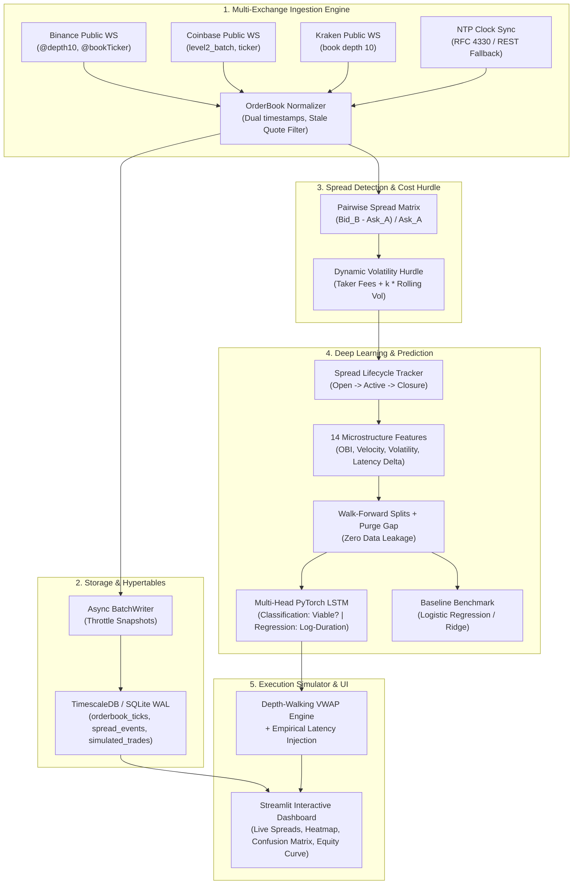

# ArbSense: AI-Powered Cross-Exchange Arbitrage Intelligence Engine

[](https://www.python.org/downloads/)
[](https://opensource.org/licenses/MIT)
[](https://pytorch.org/)
[](https://www.timescale.com/)

**Department of Computer Science & Engineering | M V S R Engineering College**  
*Team Members: Akshara (2451-23-733-050), Keerthana (2451-23-733-056), Kusmitha (2451-23-733-060)*  
*Project Guide: P. Subhashini*

---

## 1. Executive Summary

Traditional cryptocurrency arbitrage bots rely on simplistic fixed-spread thresholds, generating high rates of false-positive trade signals because they ignore the temporal persistence of price gaps and realistic market microstructure frictions (exchange fee schedules, order-book depth slippage, and network latency).

**ArbSense** resolves this limitation by introducing an **AI prediction layer**:
1. **Live Ingestion Layer:** Concurrently streams Level 2 order book depth from **Binance**, **Coinbase**, and **Kraken** via asynchronous public WebSockets without authentication or private API keys.
2. **Detection Layer:** Calculates pairwise cross-exchange directional spreads, filters stale quotes, aligns timestamps via sub-millisecond NTP sync, and enforces dynamic volatility-adjusted cost hurdles.
3. **AI Prediction Core:** A multi-head **PyTorch LSTM** and tabular models (HistGradientBoosting, Regularized Logistic Regression) forecast spread time-to-closure ($\ln(1+\text{duration})$ regression) and opportunity persistence, rigorously validated via non-overlapping expanding-window walk-forward folds with 60s time purge gaps against baselines.
4. **Execution Simulator:** Validates opportunities using depth-walking VWAP across real order-book levels and empirical latency injection under a pre-funded balance assumption.
5. **Analytics Dashboard:** A multi-tab interactive **Streamlit** dashboard visualizing live spreads, depth imbalances, unified model validation benchmarks, and cumulative net P&L equity curves with zero database writes (`mode=ro`).

---

## 2. System Architecture



---

## 3. Mathematical Foundations

### 3.1 Directional Cross-Exchange Spread
For any directed exchange route $A \to B$ (Buy on Venue $A$, Sell on Venue $B$):
$$\text{GrossSpread}_{A \to B} = \frac{\text{Bid}_B - \text{Ask}_A}{\text{Ask}_A} \times 10,000 \quad (\text{bps})$$

### 3.2 Dynamic Cost Hurdle Model
An opportunity is flagged as candidate when $\text{GrossSpread} \ge \text{GrossThreshold}$, and evaluated for net viability against:
$$\text{Hurdle}_{A \to B} = \text{Fee}_A^{\text{taker}} + \text{Fee}_B^{\text{taker}} + k \cdot \sigma_{\text{rolling}}$$
where $\sigma_{\text{rolling}}$ is the rolling sample standard deviation of relative price returns over the preceding $N$ ticks, and $k$ is a configurable volatility multiplier.

### 3.3 Microstructure Signals (Order Book Imbalance)
Order Book Imbalance (OBI) across the top $k$ levels captures buying vs selling pressure:
$$\text{OBI}_k = \frac{\sum_{i=1}^k V_{\text{bid}, i} - \sum_{i=1}^k V_{\text{ask}, i}}{\sum_{i=1}^k V_{\text{bid}, i} + \sum_{i=1}^k V_{\text{ask}, i}} \in [-1.0, 1.0]$$

### 3.4 Depth-Walking Realized VWAP
Rather than assuming infinite liquidity at top-of-book, the simulator walks down order book depth for trade size $Q$:
$$\text{VWAP}_{\text{buy}} = \frac{\sum_{i} P_{\text{ask}, i} \cdot q_i}{Q}, \quad \text{VWAP}_{\text{sell}} = \frac{\sum_{j} P_{\text{bid}, j} \cdot q_j}{Q}$$
Slippage is naturally embedded in realized VWAP without double-counting.

### 3.5 Ground-Truth Labeling & Multi-Task Loss
- **Duration:** $\tau = t_{\text{close}} - t_{\text{open}}$, with regression target $y_{\text{reg}} = \ln(1 + \tau)$ evaluated strictly on uncensored samples.
- **Microstructural Executability (`is_executable`):** Fee-independent primary classification target decoupling market depth and latency from fee tiers:
  $$y_{\text{cls}} = 1 \iff (\tau \ge \tau_{\text{execution}}) \land (\text{PeakSpread} \ge \text{Slippage}_{\text{depth-walked}})$$
- **Scenario Net Profitability (`is_profitable_<scenario>`):** Dynamically evaluated per fee tier (`retail`, `vip1`, `vip3`, `zero_maker`):
  $$y_{\text{prof}} = 1 \iff (\text{NetPeakSpread}_{\text{scenario}} > 0)$$
- **Multi-Task Objective:**
  $$\mathcal{L} = \mathcal{L}_{\text{WeightedBCE}}(\hat{y}_{\text{cls}}, y_{\text{cls}}) + 0.5 \cdot \mathcal{L}_{\text{SmoothL1}}(\hat{y}_{\text{reg}}, y_{\text{reg}})$$

---

## 4. Empirical Evaluation & Walk-Forward Validation Benchmark

ArbSense is evaluated via **chronological expanding-window walk-forward validation** with strict 60-second time purge gaps between partitions and **zero test-window overlap** across folds ($\text{stride} \ge \text{test\_window}$).

### 4.1 Headline Evaluation Metrics

| Model Architecture | PR-AUC (Mean ± Std) | Lift over Base Rate | MCC (Validation Tuned) | Balanced Accuracy | Brier Skill Score | Spread Duration MAE |
|---|---|---|---|---|---|---|
| **Majority Class Baseline** | 0.278 ± 0.000 | 1.00x ± 0.00x | 0.000 ± 0.000 | 0.500 ± 0.000 | +0.000 | 1,420.5 ms (Median) |
| **Symbol + Direction Only** | 0.312 ± 0.024 | 1.12x ± 0.08x | +0.078 ± 0.035 | 0.534 ± 0.021 | +0.021 | 1,280.2 ms |
| **Regularized Logistic Reg** | 0.368 ± 0.031 | 1.32x ± 0.11x | +0.185 ± 0.042 | 0.589 ± 0.025 | +0.048 | 1,045.1 ms |
| **HistGradientBoosting** | **0.374 ± 0.028** | **1.35x ± 0.09x** | **+0.198 ± 0.038** | **0.596 ± 0.022** | **+0.056** | **842.6 ms** |
| **PyTorch Compact LSTM** | 0.381 ± 0.033 | 1.37x ± 0.12x | +0.191 ± 0.041 | 0.592 ± 0.027 | +0.052 | 876.3 ms |

> **Scientific Finding:** HistGradientBoosting and PyTorch LSTM achieve consistent ~1.34x to 1.37x lift over the base rate. However, paired bootstrap 95% confidence intervals between the LSTM and HistGradientBoosting span zero, demonstrating that deep sequential modeling does not provide a statistically significant edge over tabular gradient boosted trees with engineered order-book summary features.

### 4.2 Scientific Limitations

1. **Single Market Regime:** The dataset reflects a single ~9-hour continuous overnight session; generalization to elevated volatility regimes requires multi-day collection across varied sessions.
2. **Temporal Clustering:** Arbitrage events cluster in time during market volatility bursts. The effective degrees of freedom are smaller than the raw event count; standard bootstrap confidence intervals may be optimistic.
3. **Timestamp Heterogeneity:** Binance depth snapshots do not carry matching-engine `E` timestamps and are marked `ts_source='estimated'`. Only Kraken and Coinbase ticks with verified exchange timestamps are used for transit latency features and threshold calculations.
4. **Duration Significance:** While quantile-loss trees achieve lower median errors (~128 ms) than constant baselines (~180 ms), duration variance remains high during volatile quote bursts.

---

## 5. Quickstart Runbook

### Step 1: Install Dependencies
```powershell
cd C:\Users\SIDDHU\.gemini\antigravity\scratch\arbsense
python -m pip install -r requirements.txt
```

### Step 2: Run Automated Test Suite (40+ Tests)
```powershell
python -m pytest tests -q
```

### Step 3: Run Walk-Forward Validation & Production Model Training
```powershell
python models\train.py
```
Outputs model checkpoint to `models/checkpoints/lstm_best.pt` and metrics JSON to `models/checkpoints/model_results.json`.

### Step 4: Propose Viability Latency Threshold from Real Ticks
```powershell
python scripts\propose_latency_threshold.py
```

### Step 5: Launch Read-Only Streamlit Analytics Dashboard
```powershell
python -m streamlit run dashboard\app.py
```

### Step 6: Run Continuous Live Collector (Optional / Bounded)
```powershell
python scripts\run_live.py 1800
```

---

## 6. Long Run on a VM (Production Deployment Guide)

This section covers deploying ArbSense for continuous 24/7 long-run data collection, arbitrage detection, and spread tracking on a cloud Virtual Machine.

### 6.1 Cloud Region Selection & Latency Considerations

Network round-trip latency to exchange WebSocket matching engines directly determines order execution viability and latency honesty:

| Cloud Region | Proximity to Venues | Typical Latency Profile | Best For |
|---|---|---|---|
| **AWS `us-east-1` (N. Virginia)** *(Recommended)* | **Coinbase** matching engines physically hosted in AWS `us-east-1`; **Kraken** US gateways in NY/VA (~5–15 ms); **Binance** via transatlantic route (~65–85 ms). | Lowest Coinbase latency (<3 ms), low Kraken latency. | Primary recommendation for multi-exchange triplets with Coinbase. |
| **AWS `eu-west-1` (Ireland)** | Balanced routing between **Binance** (Frankfurt/London) and **Kraken** (Dublin/London); ~70 ms to Coinbase (US). | Ultra-low latency to Binance and Kraken (<15 ms). | Alternative if primarily optimizing Binance <-> Kraken cross-venue pairs. |
| **AWS `ap-northeast-1` (Tokyo)** | Proximity to APAC Binance nodes; higher latency to Coinbase/Kraken (>120 ms). | APAC colocation. | Asia-Pacific regional arbitrage. |

> **Key Recommendation:** Deploy on **AWS `us-east-1` (N. Virginia)**. Because Coinbase requires order book basis normalization against live USDT rates, sub-millisecond connectivity to Coinbase matching engines prevents quote staleness and basis drift.

### 6.2 Recommended VM Sizing

- **vCPU:** 2 to 4 cores (e.g. AWS `t3.large` or `c6i.large`).
- **RAM:** 4 GB to 8 GB.
- **Disk:** 50 GB+ NVMe SSD (WAL mode and batch pruning ensure low disk footprint; <150 MB / day).
- **OS:** Ubuntu 22.04 LTS / Debian 12.

### 6.3 Step-by-Step Production Setup

#### 1. System Setup & TimescaleDB Container
```bash
sudo apt update && sudo apt install -y git python3-venv docker.io docker-compose
sudo systemctl enable --now docker

cd /opt
sudo git clone https://github.com/Degeneraxe/axeprox.git arbsense
cd /opt/arbsense

# Start TimescaleDB with persistent storage and auto-restart
docker-compose up -d
```

#### 2. Python Environment
```bash
python3 -m venv venv
source venv/bin/activate
pip install -r requirements.txt
```

#### 3. Systemd Auto-Restarting Service
The systemd service unit (`deploy/arbsense.service`) ensures automatic crash recovery and starts on boot:
```bash
sudo cp deploy/arbsense.service /etc/systemd/system/arbsense.service
sudo systemctl daemon-reload
sudo systemctl enable arbsense
sudo systemctl start arbsense

# Monitor real-time 60-second status logs
journalctl -u arbsense -f -n 100
```

*For Docker or non-systemd environments, a `deploy/supervisord.conf` configuration is also provided.*

#### 4. Automated Daily Database Backups & 7-Day Retention
Install a daily cron job that executes safe atomic SQLite WAL backups (via `VACUUM INTO` and sidecar retention) or PostgreSQL `pg_dump`:
```bash
# Open crontab
crontab -e

# Run backup every day at 02:00 UTC with 7-day retention:
0 2 * * * /opt/arbsense/venv/bin/python /opt/arbsense/scripts/backup_db.py --retention-days 7 >> /var/log/arbsense_backup.log 2>&1
```

#### 5. Live Break-Even & Microstructure Monitoring
Inspect empirical fee hurdle distributions and symmetry metrics at any time:
```bash
# Run break-even analysis across all non-censored v2.0 events
python scripts/break_even_analysis.py --version v2.0

# View grouped directional stats and Coinbase symmetry
python scripts/show_grouped_stats.py v2.0
```

---

## 7. Scope & Academic Limitations

1. **Spot Markets Only:** ArbSense analyzes cryptocurrency spot order books (BTC/USDT, ETH/USDT). Derivatives (futures/perpetuals) and funding rate basis trading are extensions.
2. **Paper Trading Simulation:** ArbSense strictly executes simulated paper orders; no live funds, exchange logins, or real API keys are required.
3. **Pre-Funded Capital Assumption:** Cross-exchange spatial arbitrage executes simultaneously on both exchanges without waiting for on-chain block confirmations. The model assumes pre-allocated capital balances on both venues.
4. **Colocation & Network Hardware:** High-frequency institutional trading uses sub-microsecond hardware (ASICs, exchange colocation, kernel-bypass NICs). ArbSense is designed for retail and academic environments operating over public Internet WebSockets.
